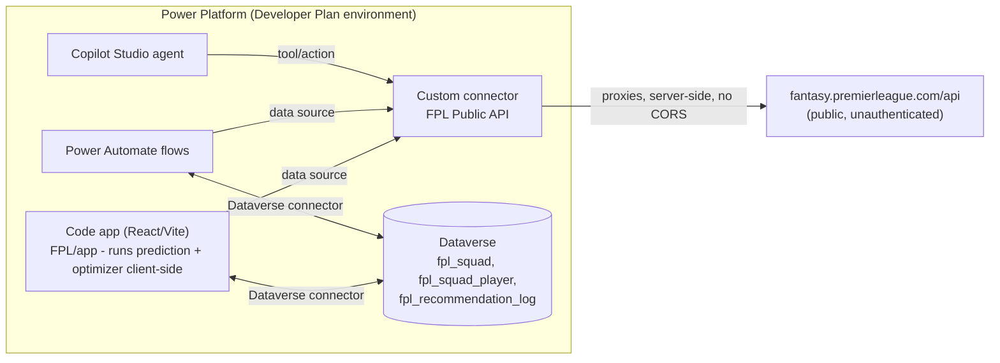

# FPL Transfer Assistant - Setup Guide

A Power Apps **code app** (React + TypeScript, hosted on Power Platform) that
lets you enter your Fantasy Premier League squad, view upcoming fixture
difficulty, and get transfer recommendations from a multi-gameweek expected
points model - plus an optional Copilot Studio agent for conversational
"what should I do this week?" questions.

## Architecture



No Azure subscription is required - everything runs inside Power Platform.

- **`FPL/app`** - the code app UI: squad builder, fixture list, transfer
  tips. All prediction/optimization math (`app/src/lib/scoring.ts`,
  `optimizer.ts`, `projections.ts`) runs client-side in the browser. FPL data
  comes via a Vite dev proxy locally, or the custom connector once published
  (see `docs/custom-connector.md`).
- **`FPL/docs`** - FPL rules grounding doc, custom connector definition,
  Dataverse schema, and Power Automate/Copilot Studio wiring instructions.

## Prerequisites

| Requirement | Notes |
|---|---|
| Node.js LTS + npm | Already installed in this workspace |
| Git | Already installed |
| Power Apps CLI (`pac`) | Already installed (v2.9.3) |
| A Power Platform environment with **code apps enabled** | Admin must toggle this in the Power Platform admin center - see below |
| Power Apps **Developer Plan** | Free, gives you a personal Dataverse-enabled environment. [Sign up](https://make.powerapps.com/) if you don't have one. Sufficient for building/testing this app. |
| Copilot Studio | The free Developer Plan environment includes a personal Copilot Studio environment for building/testing agents; publishing for others to use may require a paid Copilot Studio/Power Apps Premium license. |

### Enable code apps on your environment

1. Go to the [Power Platform admin center](https://admin.powerplatform.microsoft.com).
2. **Environments** -> select your Developer Plan environment -> **Settings**
   -> **Product** -> **Features**.
3. Turn on **Enable code apps**, then **Save**.

## 1. Run the code app locally

```powershell
cd FPL/app
npm install               # already done if you followed this session
npm run dev
```

The Vite dev server proxies `/fpl-proxy/*` to `fantasy.premierleague.com/api`
(see `vite.config.ts`), so the "My Squad", "Fixtures", and "Transfer Tips"
tabs work end to end against live FPL data with no extra services to run.

## 2. Create the custom connector (replaces the dev proxy in production)

Follow `docs/custom-connector.md` to create the "FPL Public API" custom
connector and add it to the code app with `pac code add-data-source`. This
is what lets the *published* app call the FPL API without hitting the
browser's CORS restriction (the dev-server proxy only works locally).

## 3. Initialize and publish the code app to Power Platform

```powershell
cd FPL/app
pac auth create --url https://<your-env>.crm.dynamics.com   # sign in interactively
pac code init --displayName "FPL Transfer Assistant"
npm run build
pac code push
```

`pac code init` links this folder to your Power Platform environment
(creates `power.config.json`). `pac code push` publishes the compiled app.
Run `pac code run` first if you want to test against the managed connection
layer locally before publishing.

## 4. Add Dataverse as a data source (replaces localStorage)

Follow `docs/dataverse-schema.md` to create the `fpl_squad`,
`fpl_squad_player`, and `fpl_recommendation_log` tables, then:

```powershell
pac code add-data-source -a "Dataverse" -t fpl_squad,fpl_squad_player,fpl_recommendation_log
```

Update `app/src/hooks/useSquad.ts` to call the generated data source client
instead of `localStorage`.

## 5. Power Automate flows + Copilot Studio agent

Follow `docs/power-automate-flows.md` end to end:

1. Build the `FPL - Refresh Player Cache` and `FPL - Generate Recommendation`
   flows in Power Automate.
2. Create a Copilot Studio agent, attach `docs/fpl-rules-grounding.md` as a
   knowledge source, add the actions listed in that doc, and use the
   provided system instructions as a starting point.
3. Publish the agent and either embed it in the code app or share it
   directly with yourself.

## 6. Automate the Scout predicted line-up refresh (optional)

`.github/workflows/refresh-scout-lineups.yml` scrapes Fantasy Football
Scout's predicted line-ups on a schedule and upserts them into the
`cra06_scoutlineups` Dataverse table. It authenticates with an Entra ID
app registration's client-credentials flow - **no Azure subscription
required**, just a free Entra ID tenant (the same one backing your Power
Platform environment) and an Application User:

1. **Microsoft Entra admin center** (entra.microsoft.com) -> **Applications**
   -> **App registrations** -> **New registration**. No subscription needed
   for this step.
2. Under **Certificates & secrets**, create a client secret and copy its
   value immediately (it's only shown once).
3. Note the app's **Application (client) ID** and **Directory (tenant) ID**
   from the Overview page.
4. In the [Power Platform admin center](https://admin.powerplatform.microsoft.com),
   select your environment -> **Settings** -> **Users + permissions** ->
   **Application users** -> **New app user**. Add the app registration and
   assign it a security role with read/write access to `cra06_scoutlineups`
   (e.g. System Customizer, or a custom role scoped to that table).
5. In the GitHub repo, add three **Actions secrets**: `AZURE_CLIENT_ID`,
   `AZURE_CLIENT_SECRET`, `AZURE_TENANT_ID`. The workflow passes these
   straight to the Node script, which exchanges them for a Dataverse token
   directly against Entra ID - it never calls `az login` or touches an
   Azure subscription.

If these secrets aren't set (e.g. running the script locally), it falls
back to the signed-in `az` CLI session (`az login`) instead.

## Licensing notes (Developer Plan)

- The Power Apps Developer Plan environment is **free** and includes
  Dataverse + a personal Copilot Studio environment - enough to build and
  privately test everything in this project.
- Running the code app for anyone other than you (i.e., sharing it) requires
  end users to have a **Power Apps Premium** license, since code apps use
  premium capabilities (Dataverse, custom connectors).
- No Azure subscription is needed anywhere in this architecture.

## Known limitations / next steps

- The optimizer (`FPL/app/src/lib/optimizer.ts`) ranks single-player swaps
  independently; it does not search multi-player transfer combinations or
  model chip timing (wildcard/free hit/bench boost/triple captain) - see the
  code comments for why, and treat its output as a ranked shortlist rather
  than a definitive multi-transfer plan.
- Bonus points and defensive-contribution points are approximated from
  historical per-game averages, not simulated per-match BPS.
- Squad legality (budget, position counts, max-3-per-club) is validated in
  `TeamBuilder.tsx` and in the optimizer, but nothing currently stops you
  from calling the recommendation engine with an already-illegal squad -
  keep squad edits going through the UI.
